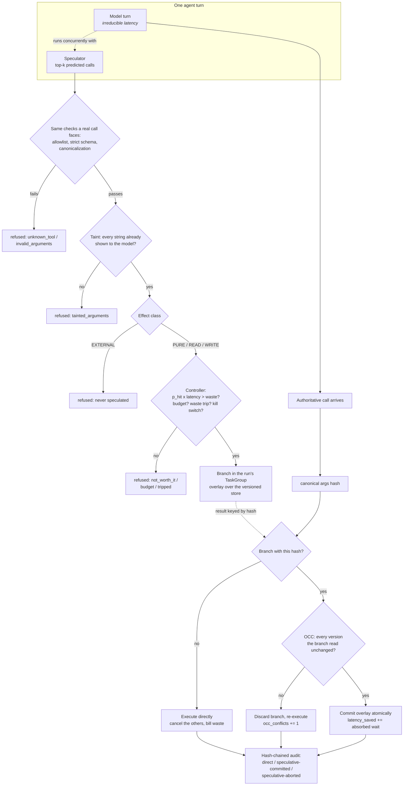

# Speculative Tool Executor

**An AI agent spends most of its time waiting. This starts the agent's next step early — while
the model is still deciding — and keeps the result only when it can prove the guess was exactly
the step the agent asked for.**

> Every latency figure in this repository comes from a **discrete-event simulation on a virtual
> clock**, driven by lognormal distributions declared in the source. They are not measurements of
> a deployed agent. [Results](#results) states exactly what is and is not being claimed.

## Problem

An AI agent works in a strict back-and-forth: the model thinks, a tool runs, the model thinks
again, another tool runs. Nothing overlaps. A person waiting on the agent pays for both halves,
one after the other, even when the next step was obvious from the moment the last one finished —
listing a folder and then reading a file from it, reading a document and then saving a note about
it.

The obvious fix is to start the likely next step early. The reason people do not is that a wrong
guess is not free, and some wrong guesses are not recoverable:

| If the guess is wrong and the work already ran | Who pays |
|---|---|
| An email, a payment or an alert went out | The recipient, and the company's reputation. It cannot be recalled. |
| A file or record was overwritten | Whoever owned the old value. The agent silently corrupted real data. |
| A stale answer was reused after the world changed | The user, who gets a confidently wrong result. |
| The guessing machinery invented a file path or a hostname nobody asked for | Security. A predictor becomes a new way to reach things. |
| Most guesses miss | Finance. Every miss is compute and tokens burned on nothing. |

This repository is an attempt to make early execution safe enough to be boring: run ahead where
it is provably harmless, refuse where it is not, and measure honestly whether the speed is worth
the waste.

## What this does

- **Starts the agent's likely next tool call while the model is still thinking**, so the two
  overlap instead of queueing.
- **Throws that early work away unless the agent asks for exactly it** — same tool, same
  arguments, compared as a single fingerprint rather than by eyeballing them.
- **Never runs ahead on anything the outside world can see.** Sending a message, or any action
  that cannot be undone, always waits for the real decision and a separate approval.
- **Holds guessed data changes in a private scratch copy** (an *overlay* — a draft nobody else
  can read) and merges it only if nothing underneath changed in the meantime.
- **Tracks what guessing costs in dollars** and switches itself off when the waste stops being
  worth the speed.

The result is verified, not asserted: across 300 generated tasks, the runs with guessing turned
on produced the same answers, the same data changes in the same order, and a byte-for-byte
identical database as the runs with it turned off.

## Architecture



### How a request flows, in words

1. **The model starts thinking.** This takes real time and nothing can shorten it.
2. **The predictor guesses what comes next.** It has seen thousands of past call sequences, so
   after a folder listing it proposes reading one of the listed files. It proposes the two most
   likely candidates, not one.
3. **Each guess is checked as if it were real.** Is that tool allowed? Do the arguments fit its
   schema exactly? The predictor gets no shortcut past any gate a genuine call must pass.
4. **Each guess is checked for where its arguments came from.** Every piece of text in a guess
   must be something the model has already been shown, or a fixed value the tool's own schema
   declares. A predictor cannot introduce a new file path or a new hostname.
5. **The kind of action decides whether it may run early.** Read-only and pure computation may.
   Data changes may, but only into a private scratch copy. Anything that reaches the outside
   world may not, ever.
6. **A cost check decides whether it is worth it.** The chance the guess is right, multiplied by
   the time it would save, is weighed against the chance it is wrong multiplied by what the
   wasted work costs. Below the line, the guess is dropped before it runs.
7. **The model finishes and names the call it actually wants.** Its arguments are reduced to a
   canonical form and hashed. If a running guess has the same hash, it is a match.
8. **The match is claimed, or discarded.** For a data change, the system re-checks that every
   value the guess read is still at the version it saw; if so, the changes are applied in one
   transaction, and the time already spent is credited as saved. If anything moved underneath, or
   there was no match, the guess is dropped and the call runs for real. Either way, a tamper-proof
   log records whether the answer came from a guess or from a direct call.

## Results

Every figure below is produced by one command, which also regenerates
[BENCHMARKS.md](BENCHMARKS.md) with the full tables, sweeps and ablations:

```bash
uv run python tasks.py bench
# runs: python bench/bench_speculation.py --check --markdown BENCHMARKS.md
```

Conditions: 300 generated tasks, predictor trained on 120 separate tasks it never sees at
evaluation time. Machine `Windows-10-10.0.19045-SP0`, Python 3.12.14, 6 CPUs. The benchmark's own
wall-clock runtime is 72.7 seconds.

| What was measured | Guessing off | Guessing on | What the number means |
|---|---:|---:|---|
| Typical run, p50 | 3.9981 s | **3.6458 s** | Half of the 300 tasks finished faster than this. A typical task got **8.8% quicker**. |
| Slow run, p95 | 5.2895 s | **5.0061 s** | The slowest 1 in 20 tasks. Those got **5.4% quicker**. |
| Time spent waiting on tools | — | **−34.6%** | The only part guessing can remove. Over a third of it is gone. |
| Eligible steps with a guess ready (coverage) | 0 | 0.7533 | About 3 in 4 steps that were allowed to be guessed had work already running. |
| Guesses that turned out right (hit ratio) | — | 0.4115 | Roughly 2 in 5 pieces of early work were used; the rest were discarded. |
| Money burned on wrong guesses | 0 | **1.5%** | 0.045 USD wasted against 2.92 USD of baseline spend over 300 tasks. The target was under 10%. |
| Tasks whose answer, data changes or database differed | 0 | **0** | Guessing changed the outcome of nothing, on any of the 300 tasks. |
| Irreversible actions taken on a guess | 0 | **0** | Nothing reached the outside world on a prediction. |

Latency is in *simulated* seconds on a virtual clock. All durations are drawn from lognormal
distributions declared in `src/speculative_tool_executor/workload/tools.py` and printed into
BENCHMARKS.md alongside the results, so a reader can disagree with the assumptions rather than
with the arithmetic.

### The target this project set itself was not met

The specification behind this project asked for a **25% or better** reduction in the typical
run. The measured figure is 8.8%. That is reported as measured rather than reframed, and the
reason is structural rather than a tuning failure.

Guessing can only remove *tool* wait. It cannot touch the time the model spends thinking, and a
test asserts that it never does. At the declared assumptions — model turn median 0.80 s
against a median tool median of 0.215 s, a ratio of roughly 3.7 to 1 — thinking dominates each
run, so removing a third of the smaller part moves the total by less than a tenth. The sensitivity
sweep makes the dependence explicit:

```bash
uv run python tasks.py bench   # "Sensitivity to the model-to-tool latency ratio" in BENCHMARKS.md
```

| Model thinking : tool time | Typical run improved by | Tool wait removed |
|---:|---:|---:|
| 1:1 | 14.3% | 28.7% |
| 2:1 | 12.1% | 35.0% |
| 4:1 | 7.6% | 36.0% |
| 7:1 | 4.9% | 36.0% |
| 10:1 | 3.9% | 36.0% |

Tool-wait reduction — the quantity the design actually controls — holds near 36% across the whole
range. The end-to-end figure simply tracks how much of a run tools account for. **If your tools
are fast relative to your model, speculation cannot help you much, and this repository will tell
you that rather than hide it.**

### Correctness when another writer is competing

```bash
uv run python tasks.py bench   # "Write contention" in BENCHMARKS.md
```

| Another party writing the same data | Guesses rejected on merge | Hit ratio | Database still identical |
|---:|---:|---:|:--:|
| never | 0 | 0.4201 | yes |
| half the time | 39 | 0.3402 | **yes** |

With another party changing the same records half the time, 39 pieces of early work were rejected
at merge and redone. The hit ratio fell from 0.42 to 0.34 and the database stayed byte-identical
to the non-guessing run. Contention costs throughput. It never costs correctness.

### The knob, and what it trades

```bash
uv run python tasks.py bench   # "Ablations" in BENCHMARKS.md
```

Raising the minimum probability the controller demands before it will guess, from 0 to 0.35,
lifts the hit ratio from 0.39 to 0.76 and cuts waste from 1.6% to 0.3% — at the price of a 3.9%
rather than 8.1% improvement in the typical run. Fewer guesses, better guesses, less speed. The
controller exists to make that trade deliberately instead of by accident.

## How it works

The load-bearing pieces, in the order they constrain each other:

| Piece | Module | What it decides |
|---|---|---|
| Effect classes | `agentic/effects.py` | `PURE`/`READ`/`WRITE` may be speculated; `EXTERNAL` never is. Registration fails without a declared effect. |
| Tool registry | `agentic/tools.py` | Allowlist, strict closed schemas, capability-vs-effect consistency, canonical call hash. |
| Canonicalization | `spec/canonicalize.py` | One representative per equivalence class of arguments. Declared per tool and field, never inferred. |
| Versioned store + overlays | `spec/store.py`, `spec/overlay.py` | Speculative writes buffer in a branch; commit validates every version the branch read (OCC). |
| Predictor | `spec/predictor.py` | Back-off n-gram over call signatures; arguments **derived** from the previous output, not memorised. |
| Taint | `spec/taint.py` | A prediction may only name strings the model has already seen, or constants the schema declares. |
| Controller | `spec/controller.py` | `p_hit x latency x value-per-second` against `(1-p_hit) x cost`, plus budget, waste trip, kill switch. |
| Speculator | `spec/speculator.py` | One `TaskGroup` per run; launches, cancels, and bills every branch exactly once. One `tool.speculate` span (`speculative=true`) per branch. |
| Executor | `spec/executor.py` | Validate, authorize, match, commit-or-discard, audit. One `tool.execute` span (`speculative=false`) per call, carrying how it was served. |
| Virtual clock | `spec/clock.py` | Simulates time inside a real event loop; advances only when every participant is asleep. |

### The central trade-off

The obvious design for speculative writes is **write eagerly, undo on a miss**: apply the write to
the real store, and compensate if the prediction was wrong. That is how saga-style systems work,
and it is what the first sketch of this project did. It was abandoned for one reason: a
compensating action is itself an action. It can fail, it can race another writer, and while it is
pending the wrong value is visible to everyone. "It leaves no trace" becomes a case-by-case
argument rather than a property.

The design that shipped inverts it. A speculative write never reaches the store at all; it
accumulates in a per-branch overlay, and the store is touched only inside the commit transaction
that first re-validates every version the branch read. Aborting is therefore not an operation on
the store — it drops a buffer. That is why "an aborted branch leaves the store byte-identical"
can be proved over arbitrary randomised operation sequences instead of argued example by example.
The cost is real: correctness is now bought with rejected work, which is exactly what the 39
rejections under contention are.

### Two details that are easy to get wrong

**The handler runs first; the simulated latency is spent afterwards.** A real read observes the
world when it is *sent*, not when its reply arrives. That ordering is what gives the version
check something to catch, and it means cancellation safety cannot come from "it never executed" —
it comes from the effect classes and the overlay.

**Speculation is scoped to a `TaskGroup` the run owns.** When the run ends, for any reason, every
outstanding branch is cancelled and awaited before the group exits. No speculation outlives the
run that started it.

### Decision records

- [ADR 2 — Effect classes decide what may be speculated, and only irreversible reach needs approval](docs/adr/0002-effect-classes-and-the-approval-boundary.md)
- [ADR 3 — Speculative writes buffer in per-branch overlays, validated by optimistic concurrency control](docs/adr/0003-overlays-and-occ-instead-of-compensation.md)
- [ADR 4 — Simulate time inside a real asyncio event loop, not around it](docs/adr/0004-virtual-clock-inside-a-real-event-loop.md)
- [ADR 5 — Predictions derive their arguments from the previous output, and may only name what the model has seen](docs/adr/0005-predictions-derive-arguments-and-are-taint-checked.md)

## Security

Guessing ahead widens what a system does before anyone asked for it, which is a security problem
before it is a performance one. Every control below has a test behind it; [CLAIMS.md](CLAIMS.md)
maps each claim to the test, and [docs/THREAT_MODEL.md](docs/THREAT_MODEL.md) gives the reasoning.

**Nothing irreversible ever happens on a guess.** Sending a message is outside the set of actions
that may run early, and three independent layers enforce it: the component that chooses guesses
refuses by category rather than by accident, the component that runs them re-checks instead of
trusting its caller, and the tool handler itself raises if it finds it is running speculatively.
Each layer is tested against a predictor that is deliberately *trying* to trigger the send.

**A guessed data change cannot be seen by anyone until it is confirmed.** It accumulates in a
branch overlay and reaches SQLite only inside the commit transaction. A property-based test over
randomised operation sequences shows an aborted branch leaves the database byte-identical.

**Work that has gone stale cannot be committed.** The commit re-validates every version the branch
read, in the same `BEGIN IMMEDIATE` transaction that applies the writes. A property test over
randomised interleavings shows the commit succeeds *if and only if* the read set is unchanged.

**Approval covers one exact call and nothing else.** An approval binds a single canonical argument
hash to a single principal, is single-use, expires, and cannot be granted by whoever requested it.
Change any argument and the hash changes, so the approval no longer applies.

**The predictor is treated as an attacker, not as a helper.** Predictions pass every gate a real
call passes, plus two more: they may only name text the model has already been shown or constants
the schema declares, and they must clear the controller's cost test. A predictor — including an
LLM drafter, whose output is untrusted by construction — cannot invent a path, a host or a
recipient and have it executed. The check that walks an argument is bounded, and the bound fails
closed: an argument too large to finish checking is refused, so padding is not a bypass.

**Instructions hidden in tool output are contained by structure, not by the model's judgement.** A
deliberately gullible fake model that obeys a `CALL_TOOL` line planted in a document still sends
nothing, because the call stops at the approval gate. Containment does not depend on the model
resisting the injection.

**Reads stay inside the workspace.** Paths are normalised *without* clamping leading `..`, so a
traversal attempt still looks like one and is refused rather than laundered into something that
passes. Outbound HTTP reaches only the bundled fake service.

**Spending is capped and there is an off switch.** A speculative budget separate from the agent's
own, a waste-ratio trip that disables guessing mid-run once it stops paying, and
`APP_SPECULATION_ENABLED=false` plus `APP_SPECULATION_DISABLED_TOOLS` as environment overrides —
both tested end to end.

**Every call is logged as direct or guessed, in a chain that detects editing.** One hash-chained
entry per call marked `direct`, `speculative-committed` or `speculative-aborted`, plus launch and
abort records. Editing any entry is detected. Cutting entries off the *end* is detected by a
writer that still has the log open, or by `--expect-head` against a head hash kept elsewhere; a
log handed over cold with no anchor can only be shown to be internally consistent (see the threat
model's residual risks).

**Traces tell guesses apart from calls.** Each branch is a `tool.speculate` span with
`speculative=true`; each authoritative call is a `tool.execute` span with `speculative=false` and
a `speculation.mode`, linked to the branch that served it by `call.hash`. The demo verifies this
on its own trace, live.

The HTTP service adds API-key authentication, rate limiting, body-size limits, explicit CORS
origins and PII redaction in logs, with `/v1/speculation` deliberately exposing the hit ratio
*and* the waste ratio together, so the benefit can never be read without its cost.

## Quickstart

Everything here runs **offline with no API key**. The model is a scripted fake that replays
reference trajectories, the tools are local fixtures, and the tests block non-loopback sockets.
`ANTHROPIC_API_KEY` is read only by the optional `AnthropicProvider`, which nothing in the default
paths constructs.

```bash
# Keep the virtualenv off the project drive if you like; any location works.
export UV_PROJECT_ENVIRONMENT=~/.venvs/speculative-tool-executor
uv sync

uv run python tasks.py demo        # offline A/B, latency waterfall, cost table, safety checks
uv run python tasks.py test        # full suite, property tests included
uv run python tasks.py bench       # the numbers in Results, regenerates BENCHMARKS.md
uv run python tasks.py check       # lint + typecheck + test + audit + baseline
```

`Makefile` and `tasks.py` have the same targets, so `make` is optional and Windows works either
way.

### What the demo prints

A per-call waterfall on the virtual clock, then a span summary of the same task's trace (the span
counts cover a warm-up run of the task plus the run shown):

```
  task task-0002 (audit_module), speculation ON
  tool          mode                     wait  saved  timeline
  ------------- ---------------------- ------ ------  ------------------------------------------------------
  list_dir      direct                   0.18   0.00                        ===
  read_file     speculative-committed    0.00   0.16                                             #
  save_note     speculative-committed    0.00   0.20                                                 #
  total elapsed 3.49s (model 3.31s, tool wait 0.18s); '#' = served from a speculative branch, '=' = waited for
  spans: 6 tool.execute (speculative=false), 8 tool.speculate (speculative=true), 4 calls served from one
```

The first call always waits — there is nothing to predict from yet. The next two were already
finished when the model asked for them.

It ends with eight safety checks, run live rather than asserted in prose, all `[ok]`: identical
outputs, identical committed writes, a byte-identical store, no external tool speculated, the
injected instruction sent nothing, the audit chain verifies, a tampered copy is rejected, and the
trace marks speculative work apart from the authoritative calls that claimed it.

## Non-goals

- **This is not a measurement of a real agent.** It is a simulator with declared latency
  distributions. The right way to read the numbers is "what this design does under these stated
  assumptions", and the sweeps exist so you can find the assumptions that match your system.
- **The 25% typical-run target is not met** at the default latency ratio, for the structural
  reason given in [Results](#results). It is reported as measured rather than reframed.
- **No LLM drafter is implemented.** The specification allows an optional `claude-haiku-4-5`
  drafter alongside the n-gram predictor. Only the `Predictor` protocol and the Markov
  implementation ship; a drafter would need network access, which the offline constraint rules out
  for tests, demo and bench alike. The taint rule and effect checks that would contain such a
  drafter are implemented and tested.
- **The predictor is a back-off n-gram, not a good model.** It cannot see the operator's prompt,
  so when a task says "read `src/auth/api.py`" it can only guess which listed file follows a
  `list_dir`. The `read_bias` sweep quantifies exactly how much that costs.
- **No distributed coordination.** One process, one SQLite store, one agent run at a time. OCC
  protects against concurrent writers to the same store file, and that is the whole concurrency
  story.
- **Not a general agent framework.** The agent loop exists to exercise the executor. It is
  single-tool-call-per-turn, scripted from reference trajectories, and deliberately boring.
- **No trace collector is bundled.** Spans are recorded in-process (`none`) or printed
  (`console`); shipping them to a collector means adding an OTLP exporter and passing it to
  `build_tracer_provider`. The tests and the demo read spans from an in-memory exporter.
- **Containers are configured, not verified here.** `Dockerfile` and `docker-compose.yml` are
  adapted to this project; `gitleaks`, `semgrep`, `trivy`, `syft` and `hadolint` run in CI only.

## Repository map

```
src/speculative_tool_executor/
  spec/        the pattern: clock, latency, store, overlay, canonicalize, cache,
               predictor, taint, controller, runner, speculator, executor, metrics
  workload/    the benchmark: generated corpus, effect-typed tools, task generator
  sim/         the agent loop, the A/B harness, the sweeps, the demo
  agentic/     provider protocol (Fake/Replay/Anthropic), tools, approvals, budgets, audit
  core/        settings, redacting logs, tracing, metrics, hardened FastAPI app
bench/         bench_baseline.py (micro), bench_speculation.py (the Results section)
docs/          THREAT_MODEL.md, adr/
```

Every claim in this README is mapped to the test, benchmark or CI job that holds it up in
[CLAIMS.md](CLAIMS.md). A row there that points at something which does not exist fails the
build.

## License

MIT. See [LICENSE](LICENSE).
