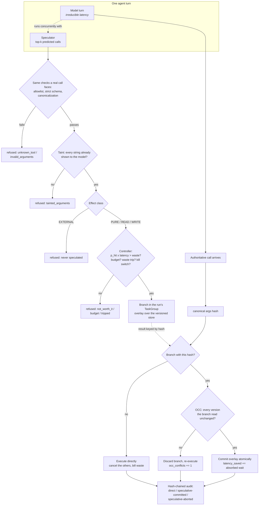

# Speculative Tool Executor

Run an agent's *next* tool call while the model is still deciding on it, and commit the result
only when the call the model actually makes is provably the same one. Effect typing decides what
may be run early; per-branch write overlays with optimistic concurrency control decide what may
be kept.

> Every latency figure in this repository comes from a **discrete-event simulation on a virtual
> clock**, driven by lognormal distributions that are declared in the source. They are not
> measurements of a deployed agent. See [Results](#results) for what is and is not being claimed.

## Problem

An agent loop is serial: model turn, tool call, model turn, tool call. The model cannot start
thinking about step *n+1* until step *n*'s result arrives, so wall-clock time is the sum of two
things that never overlap — even when the next call is highly predictable, like a read after a
list, or a note written after a file is read.

Speculating on that predictability is easy. Doing it safely is not:

- a mispredicted **write** must leave no trace, and "undo it afterwards" is not good enough;
- a speculative **read** can go stale between running and being claimed;
- an **external** effect — a message sent, a payment made — cannot be taken back at all;
- a predictor that can invent arguments is a new way to reach files and hosts nobody asked for;
- and every miss costs money, so an unprofitable speculator has to notice and stop.

## Architecture



The load-bearing pieces, in the order they constrain each other:

| Piece | Module | What it decides |
|---|---|---|
| Effect classes | `agentic/effects.py` | `PURE`/`READ`/`WRITE` may be speculated; `EXTERNAL` never is. Registration fails without a declared effect. |
| Tool registry | `agentic/tools.py` | Allowlist, strict closed schemas, capability-vs-effect consistency, canonical call hash. |
| Canonicalization | `spec/canonicalize.py` | One representative per equivalence class of arguments. Declared per tool and field, never inferred. |
| Versioned store + overlays | `spec/store.py`, `spec/overlay.py` | Speculative writes buffer in a branch; commit validates every version the branch read (OCC). |
| Predictor | `spec/predictor.py` | Back-off n-gram over call signatures; arguments **derived** from the previous output, not memorised. |
| Taint | `spec/taint.py` | A prediction may only name strings the model has already seen, or constants the schema declares. |
| Controller | `spec/controller.py` | `p_hit x latency x value-per-second` against `(1-p_hit) x cost`, plus budget, waste trip, kill switch. |
| Speculator | `spec/speculator.py` | One `TaskGroup` per run; launches, cancels, and bills every branch exactly once. |
| Executor | `spec/executor.py` | Validate, authorize, match, commit-or-discard, audit. |
| Virtual clock | `spec/clock.py` | Simulates time inside a real event loop; advances only when every participant is asleep. |

Two design notes that are easy to get wrong:

**The handler runs first; the simulated latency is spent afterwards.** A real read observes the
world when it is *sent*, not when its reply arrives. That ordering is what gives OCC something to
catch, and it means cancellation safety cannot come from "it never executed" — it comes from the
effect classes and the overlay.

**Speculation is scoped to a `TaskGroup` that the run owns.** When the run ends, for any reason,
every outstanding branch is cancelled and awaited before the group exits. No speculation outlives
the run that started it.

## Quickstart

```bash
# Keep the virtualenv off the project drive if you like; any location works.
export UV_PROJECT_ENVIRONMENT=~/.venvs/speculative-tool-executor
uv sync

uv run python tasks.py demo        # offline A/B, latency waterfall, cost table, safety checks
uv run python tasks.py test        # 500+ tests, property tests included
uv run python tasks.py bench       # the numbers in Results, regenerates BENCHMARKS.md
uv run python tasks.py check       # lint + typecheck + test + audit + baseline
```

There is no `make` requirement: `Makefile` and `tasks.py` have the same targets, and `tasks.py`
runs on Windows too. **Nothing here needs an API key.** The tests, the demo and the benchmarks
run entirely offline against a scripted `FakeProvider`; `ANTHROPIC_API_KEY` is only read by the
optional `AnthropicProvider`, which nothing in the default paths constructs.

The demo prints a per-call waterfall on the virtual clock:

```
  tool          mode                     wait  saved  timeline
  ------------- ---------------------- ------ ------  ------------------------------
  list_dir      direct                   0.18   0.00                        ===
  read_file     speculative-committed    0.00   0.16                             #
  save_note     speculative-committed    0.00   0.20                              #
  total elapsed 3.49s (model 3.31s, tool wait 0.18s)
```

## Results

Produced by `uv run python tasks.py bench`, which runs
`bench/bench_speculation.py --check --markdown BENCHMARKS.md`. Full tables, sweeps and ablations
are in [BENCHMARKS.md](BENCHMARKS.md), which the benchmark generates; it also writes the raw
JSON to `bench/results/speculation.json` locally (not committed, since it changes on every run).

Machine: `Windows-10-10.0.19045-SP0`, Python 3.12.14, 6 CPUs. 300 generated tasks, predictor
trained on 120 disjoint tasks, benchmark wall-clock runtime 65.1s.

| Metric | Speculation off | Speculation on |
|---|---:|---:|
| End-to-end p50 (simulated seconds) | 3.9981 | 3.6458 |
| End-to-end p95 (simulated seconds) | 5.2895 | 5.0061 |
| Total tool wait (simulated seconds) | — | **−34.6%** |
| Speculative calls / speculatable calls (coverage) | 0 | 0.7533 |
| Hit ratio (committed / launched) | — | 0.4115 |
| Wasted spend / baseline spend | — | 0.0154 |
| Tasks whose output, writes or store diverged | 0 | **0** |
| External effects from speculation | 0 | **0** |

**End-to-end p50 fell 8.8% and p95 fell 5.4%.** The specification this project was built from
set a target of ≥25% p50. That target is **not met**, and the reason is structural rather than a
tuning failure: speculation can only remove *tool* wait, and at the declared latency assumptions
(model turn median 0.80s, median tool median 0.215s — a 3.7:1 ratio) tool calls are about 19% of
a run. Removing 34.6% of 19% is ~6.6%, and the measured 8.8% is consistent with that. The
sensitivity sweep makes the dependence explicit:

| Model:tool latency ratio | p50 reduction | Tool-wait reduction |
|---:|---:|---:|
| 1:1 | 14.3% | 28.7% |
| 2:1 | 12.1% | 35.0% |
| 4:1 | 7.6% | 36.0% |
| 7:1 | 4.9% | 36.0% |
| 10:1 | 3.9% | 36.0% |

Tool-wait reduction — the thing the design actually controls — is stable at ~36% across the
range; the end-to-end figure simply tracks how much of the run tools account for. **If your tools
are fast relative to your model, speculation cannot help you much, and this repository will tell
you that rather than hide it.**

Two more results worth stating plainly:

- **Cost.** 0.045 USD wasted against 2.92 USD of baseline spend over 300 tasks (1.5%, target
  <10%). Tool costs are declared assumptions; token counts are the ones the fake provider
  estimated from real prompts, priced as `claude-sonnet-5`.
- **Correctness under contention.** With another party writing the keys speculations read half
  the time, 39 branches were rejected by OCC and the hit ratio fell from 0.42 to 0.34 — and the
  store stayed byte-identical to the non-speculative run. Conflicts cost throughput, never
  correctness.

The threshold ablation shows the trade-off the controller exists to make: raising the minimum
probability to 0.35 lifts the hit ratio to 0.76 and cuts waste to 0.3%, at the price of a 3.9%
rather than 8.1% p50 reduction.

## Security

Every control below has a test; see [CLAIMS.md](CLAIMS.md) for the mapping and
[docs/THREAT_MODEL.md](docs/THREAT_MODEL.md) for the reasoning.

- **External effects are never speculated.** `EXTERNAL` is outside `SPECULATABLE_EFFECTS`; the
  speculator refuses it by effect (not incidentally), the runner re-checks at launch, and the
  tool handler itself raises if it finds a speculative branch. Three independent layers, each
  tested with a predictor that is *trying* to run it.
- **Speculative writes cannot be observed.** They buffer in a branch overlay and reach SQLite
  only inside the commit transaction. A property test over randomised operation sequences shows
  an aborted branch leaves the store byte-identical.
- **Stale work cannot be committed.** Commit validates every version the branch read, in the same
  `BEGIN IMMEDIATE` transaction that applies the writes. A property test over randomised
  interleavings shows commit succeeds *if and only if* the read set is unchanged.
- **Approvals bind to the exact call.** An approval covers one canonical argument hash for one
  principal, is single-use, expires, and cannot be granted by the requester. Changing any
  argument changes the hash and the approval no longer applies.
- **Predictions pass the same gates as real calls**, plus two more: the taint rule (only strings
  the model has already seen, or schema constants) and the controller's cost test. A predictor —
  including an LLM drafter, whose output is untrusted by construction — cannot invent a path, a
  host or a recipient and have it executed.
- **Injected instructions are contained structurally.** A deliberately gullible fake model that
  obeys a `CALL_TOOL` line planted in tool output still sends nothing: the call stops at the
  approval gate. Containment does not depend on the model resisting.
- **Reads are jailed.** Paths are normalised *without* clamping leading `..`, so a traversal
  attempt still looks like one and is refused rather than laundered. HTTP reads reach only the
  bundled fake service.
- **Budgets and a kill switch.** A speculative spend budget separate from the agent's own; a
  waste-ratio trip that disables speculation mid-run; `APP_SPECULATION_ENABLED=false` and
  `APP_SPECULATION_DISABLED_TOOLS` as environment overrides, both tested end to end.
- **Audit.** One hash-chained entry per call, marked `direct`, `speculative-committed` or
  `speculative-aborted`, plus launch and abort records. Editing any entry is detected.
- The service adds API-key auth, rate limiting, body-size limits, explicit CORS origins and PII
  redaction in logs, with `/v1/speculation` exposing hit ratio *and* waste ratio together.

## Non-goals

- **This is not a measurement of a real agent.** It is a simulator with declared latency
  distributions. The right way to read the numbers is "what this design does under these stated
  assumptions", and the sweeps exist so you can find the assumptions that match your system.
- **The ≥25% p50 end-to-end target is not met** at the default latency ratio, for the structural
  reason given in [Results](#results). It is reported as measured rather than reframed.
- **No LLM drafter is implemented.** The spec allows an optional `claude-haiku-4-5` drafter
  alongside the n-gram predictor. Only the `Predictor` protocol and the Markov implementation
  ship; a drafter would need network access, which the offline constraint rules out for tests,
  demo and bench alike. The taint rule and effect checks that would contain such a drafter are
  implemented and tested.
- **The predictor is a back-off n-gram, not a good model.** It cannot see the operator's prompt,
  so when a task says "read `src/auth/api.py`" it can only guess which listed file follows a
  `list_dir`. The `read_bias` sweep quantifies exactly how much that costs.
- **No distributed coordination.** One process, one SQLite store, one agent run at a time. OCC
  protects against concurrent writers to the same store file, and that is the whole concurrency
  story.
- **Not a general agent framework.** The agent loop exists to exercise the executor. It is
  single-tool-call-per-turn, scripted from reference trajectories, and deliberately boring.
- **Containers are configured, not verified here.** `Dockerfile` and `docker-compose.yml` are
  adapted to this project; `gitleaks`, `semgrep`, `trivy`, `syft` and `hadolint` run in CI only.

## Repository map

```
src/speculative_tool_executor/
  spec/        the pattern: clock, latency, store, overlay, canonicalize, cache,
               predictor, taint, controller, runner, speculator, executor, metrics
  workload/    the benchmark: generated corpus, effect-typed tools, task generator
  sim/         the agent loop, the A/B harness, the sweeps, the demo
  agentic/     provider protocol (Fake/Replay/Anthropic), tools, approvals, budgets, audit
  core/        settings, redacting logs, tracing, metrics, hardened FastAPI app
bench/         bench_baseline.py (micro), bench_speculation.py (the Results section)
docs/          THREAT_MODEL.md, adr/
```

## License

MIT. See [LICENSE](LICENSE).
